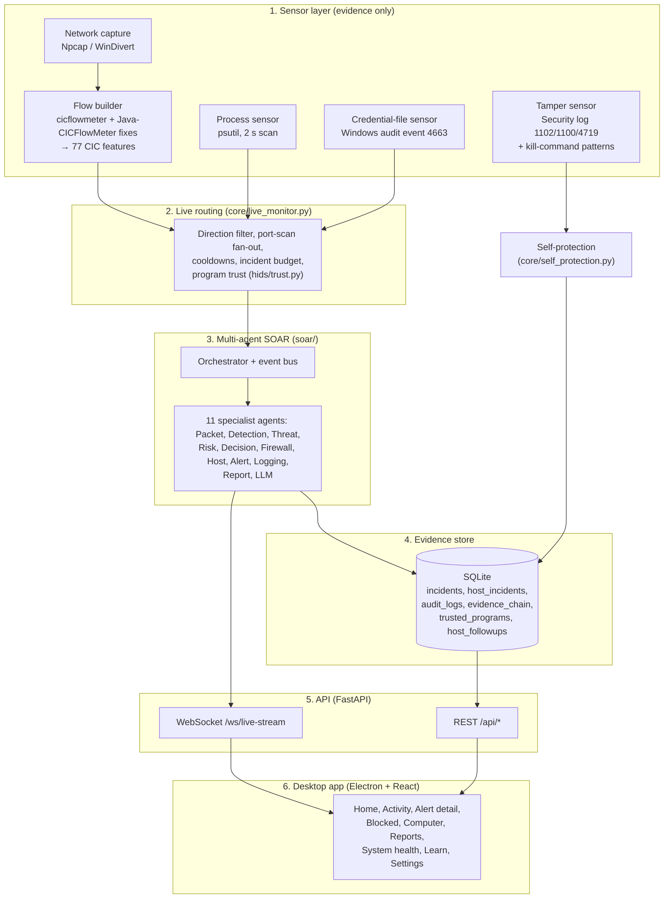
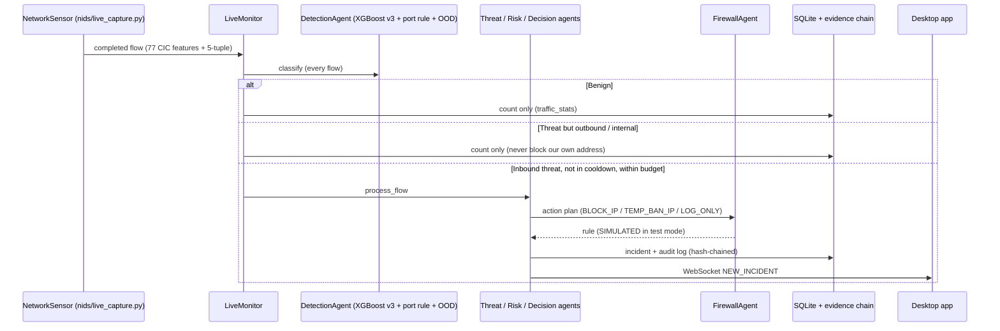
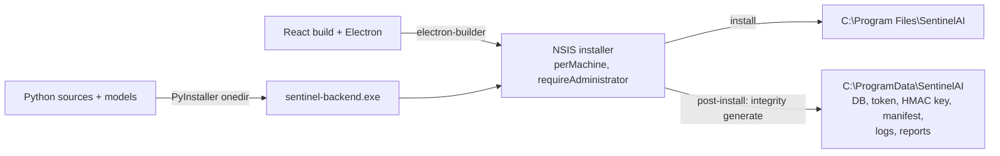

# SentinelAI — System Architecture

**Status date:** October 2026. Describes the shipped prototype (Windows installer `SentinelAI Setup 1.0.0.exe`).
**Paper use:** Section III (System Architecture). Diagrams are Mermaid; render them in VS Code / GitHub, or redraw
them in draw.io for the paper (see the figure plan in `Research_Paper_Guide.md`).

---

## 1. Design goals

| Goal | How the architecture meets it |
|------|-------------------------------|
| Detect on both network and host | Two independent sensor stacks (NIDS, HIDS) feed one response pipeline |
| Explainable to non-experts | Every incident carries MITRE ATT&CK mapping, plain-language reasons and an AI/expert-system briefing |
| Safe by default | Firewall blocks and process kills run in test mode (dry-run) unless the user acts |
| Separation of concerns | Sensors only produce evidence; only the SOAR layer decides and responds |
| Resistant to being switched off | Self-protection layer: integrity manifest, evidence hash chain, heartbeats, tamper sensor |
| Low false-alarm burden | Direction filtering, cooldowns, incident budget, code-signing reputation and user allow rules |
| Deployable | One Windows installer: bundled engine (PyInstaller), Electron app, admin elevation, data in `%ProgramData%` |

---

## 2. Layered view



**Integration rule (enforced by code review and contracts):** `nids/` and `hids/` emit evidence; they never block or
kill. `soar/` owns every response. The desktop app only talks to the SOAR API
(`soar/contracts/teammate_contracts.md`).

---

## 3. Repository → component map

| Folder | Component | Key files |
|--------|-----------|-----------|
| `ml/` | Offline dataset building, training, evaluation | `build_merged_dataset.py`, `train_xgb_v3.py`, `eval_v3_dual.py` |
| `models/` | Trained artefacts | `sentinel_xgb_v3.pkl`, `label_encoder_v3.pkl`, `feature_columns_v3.pkl`, `hids_isolation_forest.joblib` |
| `config/` | Paths, integrity manifest, secrets, runtime knobs | `paths.py`, `integrity.py`, `security.py`, `runtime.py`, `own_processes.py` |
| `nids/` | Live capture and the 77-feature bridge | `live_capture.py`, `feature_extractor.py`, `live_predict.py` |
| `hids/` | Host sensors, model scoring, trust, SOAR bridge | `process_monitor.py`, `file_monitor.py`, `tamper_monitor.py`, `predict.py`, `live.py`, `trust.py` |
| `hids/dataset/` | Safe stealer simulator, feature engineering, training | `stealer_simulator.py`, `features.py`, `build_dataset.py`, `train_model.py` |
| `soar/agents/` | The specialist agents | see Section 5 |
| `soar/core/` | Orchestrator, event bus, schemas, live monitor, watchdog, self-protection | `orchestrator.py`, `live_monitor.py`, `self_protection.py`, `watchdog.py` |
| `soar/rules/` | Policies and the out-of-distribution layer | `policies.yaml`, `policy_engine.py`, `ood_policy.py` |
| `soar/database/` | SQLite schema and hash-chained persistence | `schema.sql`, `db_manager.py` |
| `soar/api/` | FastAPI REST + WebSocket server | `server.py` |
| `dashboard/` | Electron desktop app (React 19 + TypeScript + Vite + Tailwind) | `electron/main.cjs`, `src/pages/*` |
| `packaging/` | PyInstaller build of the engine | `sentinel-backend.spec`, `build_backend.ps1` |

Implementation size (October 2026, excluding tests and generated code): about **11,200 lines of Python** in 69
modules, **4,700 lines of TypeScript/TSX** in 48 files, and **640 lines** of Electron main-process code. Automated
tests: **224** (Python unit/integration tests across `nids`, `hids`, `soar`, `ml`).

---

## 4. End-to-end data flow

### 4.1 Network path



### 4.2 Host path

```mermaid
sequenceDiagram
  participant P as Process / file sensors
  participant B as HostBridge (hids/live.py)
  participant L as LiveMonitor
  participant R as Trust (hids/trust.py)
  participant H as HostAgent
  participant U as Desktop app

  P->>B: credential-file read (immediately) / finished process run (Isolation Forest)
  B->>L: host event
  L->>L: drop process-only events from Windows / Program Files; per-program cooldown
  L->>R: evaluate(exe_path, user rules)
  alt allowed by user rule
    L-->>L: suppress, count "allowed_by_you"
  else trusted vendor (valid signature + protected folder)
    L->>H: event + trust → TrustedAccess, LOW, never auto-stopped (once/day)
  else unverified
    L->>H: event → Stealer / Anomalous, full risk, response plan
  end
  H->>U: WebSocket NEW_HOST_INCIDENT
  U->>H: user: "Stop this program now" / "Trust this program" (follow-up recorded)
```

Two host paths exist because infostealers often finish in about a second: a non-owner credential-file read goes to
SOAR immediately, while finished process runs are scored by the Isolation Forest when they exit.

---

## 5. Multi-agent SOAR layer

All agents derive from `BaseAgent` (lifecycle, status, telemetry). The orchestrator runs them in order for each
event; agents also publish to an in-memory event bus with per-subscriber error isolation, so a failing optional
agent (LLM, Telegram) never blocks blocking or logging.

| # | Agent | Responsibility |
|---|-------|----------------|
| 1 | PacketAgent | Sanitises flows (NaN/Inf, IP/port normalisation, schema checks) |
| 2 | DetectionAgent | XGBoost v3 inference → hybrid port override → OOD policy; keeps the raw ML label for transparency |
| 3 | ThreatAgent | Evidence synthesis and MITRE ATT&CK mapping (e.g. T1046, T1110.001, T1498) |
| 4 | RiskAgent | Risk score 1–10: attack weight × confidence + velocity + target sensitivity |
| 5 | DecisionAgent | Applies `policies.yaml`: whitelist, severity thresholds, ban durations |
| 6 | FirewallAgent | Windows `netsh advfirewall` rules (dry-run by default), automatic expiry and unblock |
| 7 | HostAgent | Host classification, host risk, MITRE (T1555.003, T1539, T1005), identity-verified process termination |
| 8 | AlertAgent | Dashboard queue + WebSocket, desktop toast (HIGH/CRITICAL only), optional Telegram |
| 9 | LoggingAgent | SQLite persistence |
| 10 | ReportAgent | PDF incident and summary reports (ReportLab) |
| 11 | LLMAgent | Plain-language briefing: Gemini → local Ollama (llama3) → offline expert system fallback |
| 12 | BaseAgent | Abstract base: lifecycle, health, status state machine |

---

## 6. Persistence and evidence store

SQLite database in the protected data folder `C:\ProgramData\SentinelAI\` (override `SENTINEL_DATA_DIR` /
`SENTINEL_DB_PATH`). Main tables (`soar/database/schema.sql`):

| Table | Purpose | Tamper-evident |
|-------|---------|:--------------:|
| `incidents` | Network incidents (flow, detection, risk, action, LLM text) | ✓ |
| `host_incidents` | Host incidents (process, file, classification, risk, action) | ✓ |
| `audit_logs` | Every automated and user action | ✓ |
| `evidence_chain` | HMAC-SHA256 chain over the three tables above | — |
| `blocked_ips` | Firewall rules and their status | |
| `traffic_stats` | Daily count of benign flows checked (not stored individually) | |
| `trusted_programs` | User allow rules (file SHA-256 or code-signing publisher) | |
| `host_followups` | What happened after a host alert (marked safe, stopped by user) | |

Chained rows are never updated in place: follow-ups are appended to `host_followups` and `audit_logs`, so editing
history is always detectable.

---

## 7. API surface (`soar/api/server.py`)

All routes except `/` and the docs require the per-install token header `X-SentinelAI-Token`.

| Method | Route | Purpose |
|--------|-------|---------|
| GET | `/api/status`, `/api/live/status`, `/api/metrics` | Engine, sensor and KPI status |
| GET | `/api/incidents`, `/api/incidents/{id}` | Network incidents |
| GET | `/api/host/incidents` | Host incidents (with follow-ups) |
| GET / POST | `/api/blocks`, `/api/blocks/unblock/{rule_id}` | Firewall rules, manual unblock |
| POST | `/api/flows/ingest`, `/api/host/events/ingest` | Inject a flow / host event (demo, external sensors) |
| GET / DELETE | `/api/trust`, `/api/trust/{id}` | User allow rules |
| POST | `/api/host/incidents/{id}/trust` | Mark the program behind an alert as safe (`auto` / `publisher` / `file`) |
| POST | `/api/host/incidents/{id}/terminate` | Really stop the process behind an alert (identity-checked) |
| POST | `/api/reports/generate`, GET `/api/reports/download/{file}` | PDF reports |
| GET / POST | `/api/selfprotect/status`, `/api/selfprotect/verify` | Integrity, evidence chain, watchdog |
| POST | `/api/sensors/heartbeat`, `/api/engine/stopping` | Heartbeats, planned-stop notice |
| WS | `/ws/live-stream` | Live push of alerts and incidents |

---

## 8. Desktop application

* **Electron main process** (`dashboard/electron/main.cjs`): starts and supervises the bundled engine, tray icon,
  close-to-tray, single instance, admin detection (`net session`) and "Restart as administrator", start-at-login via
  a scheduled task with highest privileges (Windows skips elevated Run-key entries), and memory saving by unloading
  the window when hidden.
* **Renderer** (React 19, TanStack Query, Recharts, Tailwind 4): two modes — **Simple** (plain language, no jargon)
  and **Expert** (IPs, model probabilities, raw JSON, demo panel). Every backend code passes through one translation
  layer (`src/lib/translate.ts`) so no raw label reaches a non-expert user.
* Pages: Home (status + live activity strip), Activity, Alert detail (story, risk gauge, what SentinelAI did,
  user decision buttons), Blocked connections, Computer protection, Reports, System health, Learn, Settings
  (including the Trusted programs list).

---

## 9. Deployment and packaging



| Item | Value |
|------|-------|
| Installer | `SentinelAI Setup 1.0.0.exe`, ~227 MB, per-machine, asks for administrator rights |
| Engine | PyInstaller one-folder build of `soar/main.py` (FastAPI + all agents + models) |
| First start | ~10 s to a ready API on a laptop-class machine |
| Post-install step | Engine records SHA-256 fingerprints of the installed models, policies and code (signed manifest) |
| Upgrade / uninstall | Installer stops the running engine and clears its run marker so the stop is not reported as tampering; incident history in `%ProgramData%` is kept |
| Capture driver | Npcap if present; otherwise the WinDivert driver bundled in `pydivert` (sniff-only, needs admin) |

---

## 10. Trust boundaries (for the security discussion)

| Boundary | Protection |
|----------|-----------|
| Other local processes → API | Random 256-bit token in an ACL-restricted file; CORS limited to app origins |
| Disk → models | Models are hashed before unpickling; a modified or unlisted model is refused |
| Disk → incident history | HMAC chain + external anchor; edits, deletions, injections and truncation are reported |
| Attacker → engine process | Heartbeat watchdog, unclean-shutdown detection (with Windows-shutdown attribution), tamper sensor |
| Signed vendor software → alerts | Reputation (signature + protected folder) and narrow user allow rules; script hosts are never trusted |

Out of scope: kernel-level self-defence (Protected Process Light, ELAM, minifilter drivers) needs signed drivers.
An administrator-level attacker can stop the service; the design goal is that this is **detected and recorded**, not
prevented.
